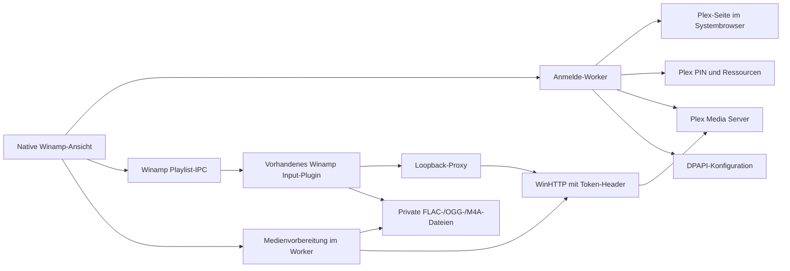

# Architektur

## Aktuelle Komponenten

Die Liste der Musikbibliotheken liegt bei aktiviertem Cache für fünf Minuten gemeinsam im Prozess vor. `LibraryCache` hält höchstens eine Liste; Schlüssel aus Serverkennung, Verbindungsrevision und Cache-Gültigkeitsbereich verhindern die Übernahme in eine andere Sitzung. Ein neuer Ansichts-Worker muss diese unveränderte Liste nicht erneut abfragen. Die erste Verbindungsprüfung einschließlich TLS und Serveridentität bleibt erforderlich. Ausschalten umgeht den Cache, Verbindungsänderung und Cache-Leeren verwerfen ihn. „Aktualisieren“ fragt auch die Bibliotheksliste neu ab. Ein abgelaufener Eintrag verdeckt keinen Netzwerkfehler; Netzwerkzugriffe laufen außerhalb der Cache-Sperre.

Auch die Miniaturen und ergänzenden Album-/Playlist-Zähler werden zwischen Ansichts-Workern geteilt. Der Cache besitzt höchstens 64 Einträge mit fünf Minuten Lebensdauer; eine Miniatur enthält höchstens 48 × 48 BGRA-Pixel. Schlüssel trennen Server, Gültigkeitsbereich und Medienkennung. Die gemeinsame Sperre schützt ausschließlich Zugriff und LRU-Verwaltung, keine Netzwerkoperation. Leeren erhöht eine Generation, damit ein zuvor gestarteter Abruf keine alten Daten wieder einträgt. Cache-Leeren, Verbindungsänderung und Plugin-Beendigung geben die Einträge frei. Die Worker bleiben kontrolliert an ihre jeweilige Ansicht gebunden.

Der begrenzte Cover-Worker aktualisiert auch Titelanzahl und Laufzeit sichtbarer Plex-Playlists. Dafür verwendet er deren Detailendpunkt, da Übersichtswerte dynamischer Playlists veraltet sein können. Die Antworten sind an die angefragte Audio-Playlist gebunden, fünf Minuten gecacht und durch Navigationsgenerationen gegen verspätete Übernahme geschützt. Playlistzeilen erhalten dabei keine Cover-Bildliste.

| Bereich | Verantwortung |
| --- | --- |
| `src/plugin` | SDK-Descriptor, Export, Knotenregistrierung, Lifecycle, Winamp-Playlist-IPC und Besitz des Wiedergabe-Proxys |
| `src/ui` | Native Unicode-Dialoge, virtuelle Tabellen, getrennte UI-Zeilen, Hintergrundaufträge, Anmeldung und Skin-Anbindung |
| `src/plex/http_stream.cpp` | Asynchrone WinHTTP-Requests, TLS, Timeouts, Abbruch, Header- und Bytezugriff |
| `src/plex/auth.cpp` | Starker PIN, Browser-Anmelde-URL, Ressourcen, Serveridentität und Musikbibliotheken |
| `src/plex/catalog.cpp` | Typisierte Modelle, Künstler, Alben, Titel, Playlists, Query-Prüfung und Pagination |
| `src/plex/feedback.cpp` | Geprüfte Bewertungs- und Timeline-Anfragen, TLS, Millisekunden und begrenzte Antwortverarbeitung |
| `src/plex/artwork.cpp` | Geprüfte relative Coverpfade, authentifizierter Bildtransport und begrenzte WIC-Decodierung |
| `src/ui/artwork_loader.cpp` | Bedarfsgesteuerte Cover-/Titelanzahlaufträge, Generationsprüfung und begrenzter Bildcache |
| `src/plugin/artwork_provider.cpp` | Cache-basierter Album-Art-Dienst für eigene Wiedergabepfade, ohne Netzwerkzugriff im Hostcallback |
| `src/cache` | Thread-sicherer LRU-Metadaten-Cache mit 32 Seiten und fünf Minuten Gültigkeit |
| `src/playback/proxy.cpp` | Loopback-Listener, begrenzte Worker, befristeter Grant und Range-Streaming |
| `src/playback/local_media.cpp` | Abbrechbare Vorbereitung von FLAC, OGG und ADTS-AAC, private Sitzungsdateien, Größenlimits und Bereinigung |
| `src/playback/aac_remux.cpp` | Verlustfreier ADTS-/M4A-Containerwechsel mit Windows Media Foundation, ohne Decoder oder Encoder |
| `src/playback/playback_reporter.cpp` | Zustandsvergleich, begrenzte Timeline-Warteschlange, Hintergrundversand und Abbruch |
| `src/config` | Benutzergebundene DPAPI-Datei und atomarer Austausch |
| `src/common` | Origin-, Token-, Pfad-, Request- und Range-Prüfung sowie Query-Encoding |
| `tests` | SDK-Host, synthetischer PMS-Transport und Tests unabhängiger Komponenten |

Die Ansicht verwendet `LVS_OWNERDATA` und lädt bis zu 250 Einträge je Seite. Suche wird verzögert ausgelöst. Ein neuer Auftrag bricht den alten ab; eine Generationsnummer verhindert die Veröffentlichung überholter Ergebnisse. Album- und Playlistwiedergabe lösen Titel im Worker auf, bevor der UI-Thread sie an Winamp übergibt.

Persönliche Titelbewertungen sind optionale Zahlen von 0 bis 10 im API-Modell. Die Ansicht zeigt sie geteilt durch zwei und bietet ein skiniertes Bewertungsuntermenü für einen einzelnen Titel. Ein Worker schreibt den Wert und liest die Metadaten zur Bestätigung zurück. Bereits nach dem erfolgreichen Schreibrequest wird der Seiten-Cache geleert, damit auch ein abgebrochenes Rücklesen keine alten Bewertungen konserviert. Ein Fehler bestätigt keine Änderung; die Oberfläche fordert dann eine erneute Prüfung durch Aktualisieren an.

Ein unsichtbares Nachrichtenfenster fragt Winamp alle 500 Millisekunden ausschließlich auf dem UI-Thread ab. Nur eigene Wiedergabepfade erhalten eine Zuordnung zu Plex-ID und Laufzeit. Titelwechsel beenden die vorige Sitzung vor dem nächsten Start; fremde Dateien und Stop beenden die eigene Sitzung. Zustandswechsel und Sprünge über zwei Sekunden werden unmittelbar, normale Fortschritte alle zehn Sekunden gemeldet. Ein separater Worker verarbeitet höchstens 64 wartende Meldungen in Reihenfolge. HTTP 401/403 beendet den automatischen Versand ohne andere Zugangsdaten auszuprobieren. Die Oberfläche zeigt klassifizierte Fehler; ein Audiofehler hat Vorrang vor einem Statusfehler. Beim Abbau erhält die letzte Stopmeldung bis zu 500 Millisekunden, danach wird eine ausstehende Anfrage abgebrochen und der Thread verbunden. Es entstehen keine zusätzlichen Player-Steuerelemente.

Mehrteilige Titel verwenden bekannte Teillaufzeiten als Positionsversatz. Sind diese nicht zuverlässig vorhanden, wird die Statusmeldung als nicht unterstützt ausgewiesen, ohne eine falsche Gesamtposition zu senden. Dieser Sonderfall ist durch Codeprüfung erfasst, nicht mit einem echten mehrteiligen Titel nachgewiesen. Ein echtes reguläres Titelende hat mit Timeline-Meldungen den Plex-Verlauf und Wiedergabezähler aktualisiert; ein zusätzlicher Scrobble-Schreibpfad ist nicht eingebaut.

Die Kopfzeile benennt die Musikbibliothek. Bei einer einzelnen Bibliothek zeigt sie deren Namen; nur mehrere Bibliotheken erhalten eine Auswahl. Der Navigationsbaum benennt die Hauptansicht. Eine zusätzliche Überschrift und „Zurück“ erscheinen erst bei Künstler- oder Album-Unteransichten. Seitenwechsel verwenden getrennte, eindeutig beschriftete Aktionen. Bei schmalen Ansichten stehen Bibliotheksname, Suchaktionen und Seitenwechsel in eigenen Zeilen.

Für sichtbare Album- und Titelzeilen arbeitet ein zusätzlicher Bild-Worker. Er lädt Originalcover über geprüfte `/library/metadata/{id}/thumb`-Pfade und skaliert sie mit Windows Imaging Component auf höchstens 48 × 48 Pixel. Download, Quelldimensionen und Pixelzahl sind begrenzt. Die Ansicht besitzt die Bildliste; GDI-Bitmaps werden nach der Übergabe freigegeben. Fehlender `thumb` oder HTTP 404 bedeutet kein Bild. Andere HTTP- oder Bildfehler werden sichtbar gemeldet. Eine fehlende Albumtitelanzahl wird über eine Kinderseite mit Größe 1 und deren Gesamtzahl ermittelt. Bis zu 64 Ergebnisse bleiben fünf Minuten im Cache.

Ein Titel verwendet seinen eigenen `thumb` oder das geerbte Albumcover aus `parentThumb`. Vor der Playlistübergabe lädt der Katalog-Worker jedes benötigte Cover einmal pro Auftrag mit maximal 256 Pixeln Kantenlänge. Der registrierte `svc_albumArtProvider` liefert ausschließlich diese vorbereiteten PNG-Daten für eigene URLs. Bilder und Dateityptexte werden über Winamps `api_memmgr` allokiert. Die Dateitypkennung lautet gemäß SDK-Providervertrag `png`, nicht `image/png`. Für Streaming-URLs verwendet der Host die Kategorie `ALBUMARTPROVIDER_TYPE_EMBEDDED`; das Plugin ordnet das Bild separat zu und verändert keine Medienbytes oder Tags. Mehrere Titel teilen dasselbe Bild; der Prozesscache ist auf 64 MiB und 10000 Zuordnungen begrenzt. Widerruf und Plugin-Beendigung entfernen Zuordnungen und registrierten Dienst. Fehlende Hostdienste werden als Initialisierungsfehler behandelt.

`ML_IPC_SKINWINDOW` bindet Dialog und direkte Steuerelemente an die Skin-Engine der Medienbibliothek. Schrift, Farben und Cursor gehören Winamp; eigene Farbpaletten werden nicht eingebaut. Kontextmenüs verwenden `ML_IPC_TRACKSKINNEDPOPUPEX`. Die Skin-Unterklassen entfernen sich bei `WM_NCDESTROY`. Die Ansicht enthält keine eigene Wiedergabesteuerung.

## Datenfluss

Plexa ist die Verhaltensreferenz für Anmeldung, Auswahl und Mediengateway. Es wird kein Node-Prozess und kein Alexa-Endpunkt eingebettet. Der Proxy ist ein internes Transportmodul, kein externer Dienst.

FLAC und OGG verwenden deterministisch lokale Dateien, da der FLAC-Decoder HTTP ablehnt und der OGG-Decoder dort keine Länge und kein Seeking liefert. Es handelt sich um denselben unveränderten Plex-Part, ohne Transcoding. Der Katalog-Worker lädt die ausgewählten Parts mit dem vorhandenen WinHTTP-Transport vollständig herunter. HTTP-Fehler, fehlende oder widersprüchliche Dateilängen, Abbruch und Limits beenden den Auftrag vor der Playlistübergabe. MP3 und vorhandene M4A-Dateien bleiben beim Proxy; ein Fehler löst keinen Wechsel des Wiedergabepfades aus.

Separate ADTS-AAC-Dateien erhalten ebenfalls vor der Playlistübergabe einen lokalen Dateipfad. Winamps HTTP-AAC-Decoder verweigert Seeking; dessen Dateipfad schätzt die Laufzeit der synthetischen Probe falsch. Media Foundation liest deshalb ausschließlich komprimierte ADTS-Samples mit abgeschalteten Konvertern. Der Worker entfernt die ADTS-Rahmung und schreibt die unveränderten AAC-Nutzdaten als `MEDIASUBTYPE_RAW_AAC1` in einen M4A-Container. Zeitstempel stammen aus den 1024 Samples je ADTS-Frame und der Abtastrate. Ein Encoder oder Decoder wird nicht angelegt. Die Bytebilanz erkennt übersprungene oder abgeschnittene Frames; bekannte ID3-Metadaten werden separat berücksichtigt. Program Config Elements, mehrere Rohdatenblöcke je Frame und mehr als zwei Millionen Frames werden abgewiesen. Eingang und Ausgang zählen während der Vorbereitung gemeinsam gegen das Speicherlimit. Fehler entfernen den angelegten Ausgang; bestehende Dateien werden nicht überschrieben. Die benötigten Windows-DLLs werden ausschließlich aus System32 und erst für AAC geladen.

Der Speicher legt Sitzungen mit 192 Bit Zufall unter dem eigenen Anwendungsordner an. Eine geschützte DACL erlaubt ausschließlich dem aktuellen Windows-Benutzer und SYSTEM Zugriff. Mediennamen enthalten ebenfalls 192 Bit Zufall und nur die geprüfte Dateiendung. Pro Datei gelten 512 MiB, insgesamt 2 GiB. Ein Lesehandle verhindert Änderungen, solange das Plugin die Datei hält. Noch geöffnete Decoderdateien bleiben beim Speicherverbrauch berücksichtigt und werden nach Freigabe erneut bereinigt. Aktuelle Titel werden vor dem Freigeben des Speichers gestoppt. Bei Prozessabbruch verbleibende Sitzungen werden nur mit passendem Marker, ausschließlich eigenen Dateinamen und ohne Reparse Points bereinigt; ein exklusiver Markerzugriff schützt parallele aktive Instanzen. Unbekannte Ordner bleiben unberührt.

Die Playlistübergabe akzeptiert lokale Dateien nur aus dem tatsächlich vom Speicher angelegten Sitzungsordner und mit exakt zufälligem FLAC-/OGG-/M4A-Namen. Metadaten und vorbereitete Cover werden dem Unicode-Dateipfad zugeordnet. Der private Dateispeicher bleibt bis Verbindungswechsel oder Plugin-Ende bestehen; die zweistündige HTTP-Grant-Laufzeit gilt für diese Dateien nicht.

## Threading und Besitz

Winamp ruft Plugin-Core und Dialogprozeduren auf seinem UI-Thread auf. Nur dieser Thread sendet Playlist-IPC und verändert Steuerelemente. Der Anmeldedialog besitzt einen Worker und ein Stop-Event. Ergebnisdaten werden unter einem Mutex veröffentlicht; `PostMessage` überträgt nur eine Benachrichtigung, keine frei schwebenden Ergebnis-Pointer.

Beim Ansichtswechsel trennt der UI-Thread Bildliste und Skin-Ressourcen und setzt die Stop-Events der Katalog- und Coverworker. `ViewReaper` übernimmt ihren noch lebenden Zustand über eine intrusive Warteschlange ohne weitere Allokation. Sein eigener Thread verbindet die Worker und gibt ihren Zustand frei; der Navigationsaufruf wartet darauf nicht. Höchstens acht ausstehende Ansichten einschließlich laufendem Abbau sind zugelassen. Bei ausgeschöpfter Grenze wird die zusätzliche Ansichtserzeugung als Fehler behandelt. Ein auf diesem Thread mit `CoInitializeEx` initialisiertes MTA-Apartment lebt für die Plugin-Sitzung und endet auf demselben Thread. Die Plugin-Beendigung zerstört zuerst sämtliche Fenster und leert danach die Aufräumwarteschlange samt Thread, bevor die DLL entladen wird. Es gibt keine detached Worker. Ein Cookie mit asynchronem MTA-Abbau wird nicht verwendet.

Der Proxy besitzt vier begrenzte Worker. Sie bedienen einen nicht blockierenden Loopback-Listener und pro Worker höchstens einen Client. Die Headergröße ist auf 16 KiB beschränkt; ein Client darf seine Header nicht unbegrenzt langsam senden. Medienbytes werden in 64-KiB-Blöcken weitergegeben, nicht vollständig im Speicher gepuffert.

WinHTTP verwendet asynchrone Handles. Ein Worker wartet auf Abschluss oder Abbruch, während die Winamp-Oberfläche weiterarbeitet. Ein WinHTTP-Callback greift nur auf seinen Request-Kontext zu. Nach `HANDLE_CLOSING` werden Verbindung und Sitzung geschlossen. Anschließend wartet der Transport auf `WINHTTP_OPTION_UNLOAD_NOTIFY_EVENT`: Erst dieses Ereignis bestätigt die Rückkehr sämtlicher Sitzungs-Callbacks, sodass deren Kontext und Plugin-Code freigegeben werden dürfen. Die bloße Zustellung von `HANDLE_CLOSING` genügt dafür nicht. [Microsoft dokumentiert das Abschlussereignis](https://learn.microsoft.com/en-us/windows/win32/winhttp/option-flags#winhttp_option_unload_notify_event). Beim Beenden werden Stop-Events gesetzt, ausstehende Requests abgebrochen und Threads verbunden. Ein eigener Thread wird nicht detached weiterlaufen gelassen.

Die Wiedergabe gehört dem Plugin-Core und überlebt das Zerstören einer Bibliotheksansicht. Ein Listener mit vier Workern verwaltet bis zu 10000 unabhängige Grants. Neue Titel widerrufen keine bereits angehängten Titel. Bei fehlgeschlagener Playlistübergabe werden nur die dabei neu ausgegebenen Grants zurückgenommen. Das Ende der Verbindung beendet alle Grants.

Die UI übergibt den Wiedergabeauftrag als Anhängen, Abspielen oder Einfügen hinter dem aktuellen Titel. `send_playlist_to_winamp` kapselt die synchronen SDK-Aufrufe und prüft den tatsächlichen Playlist-Zuwachs. Beim Einfügen erhält der Playlisteditor die vorbereitete Unicode-M3U8-Datei am gewünschten Index. Diese Aktion sendet keinen Playerbefehl. Der Wiedergabe-Reporter wird vor der Hoständerung angelegt, damit eine dabei fehlgeschlagene Ressourcenallokation keine bereits eingefügten Titel zurücklässt. Ein vom Host nur teilweise importierter Auftrag wird als Fehler gemeldet; eine atomare Rücknahme des Hostimports ist nicht zugesichert.

## Authentifizierung und Konfiguration

Ein zufälliger Client-Identifier wird mit der Verbindung gespeichert. Die Einstellungen öffnen ohne Browseranmeldung. Nur der ausdrückliche Anmeldebutton startet eine starke Plex-PIN und den Systembrowser. Das Passwort läuft ausschließlich durch Plex. Der Account-Token dient dem Abruf der Serverressourcen und wird nicht dauerhaft gespeichert. Die Serverprofile enthalten die jeweiligen Ressourcen-Tokens und die von Plex gelieferten HTTPS-Verbindungen.

Die Erreichbarkeitsprüfung untersucht bis zu 32 Verbindungen pro Server mit normalen TLS-Prüfungen und einer unauthentifizierten `/identity`-Abfrage. Lokal hat Vorrang vor direktem Fernzugriff und Relay. Erst eine passende Serveridentität erlaubt die authentifizierte Bibliotheksabfrage. Ein Authentifizierungsfehler startet keine weitere Verbindungssuche. Manuelle Verbindungen stehen unter „Erweitert“ und benötigen ebenfalls eine Identitätsprüfung. Das Öffnen des Dialogs prüft die gespeicherte Verbindung und lädt die Musikbibliotheken im Hintergrund; Abbrechen speichert keine Entwurfsänderungen. Hintergrundjobs werden beim Schließen abgebrochen und beendet.

Der erste Bibliotheksauftrag eines Plugin-Starts verwendet denselben Verbindungshelfer wie die Einstellungen. Nur dieser Auftrag erhält die ausgewählten Verbindungsvarianten, keine Tokens anderer Serverprofile. Weitere Aufträge und Coveranfragen verwenden die für diese Sitzung geprüfte Origin. Eine Profilrevision verhindert, dass ein älteres Worker-Ergebnis eine inzwischen geänderte Einstellung überschreibt. Eine neue Origin beendet vorhandene Wiedergabezuordnungen und leert den Bibliothekscache; die automatische Sitzungsauswahl schreibt keine DPAPI-Datei. Nach Einstellungsänderungen wird die Verbindung erneut geprüft. Vor erfolgreicher Prüfung lässt sich keine neue Wiedergabe übergeben.

Ein nativer modaler Fensterrahmen enthält eine eingebettete gen_ml-Ansicht. Hintergrund, Beschriftungen, Auswahlfelder und Buttons verwenden dieselbe Skin-Engine wie die Medienbibliothek. Erweiterte Felder sind anfangs verborgen; beim Einblenden werden die übrigen Zeilen und der Rahmen gemeinsam angepasst. Verborgene Eingaben besitzen keine aktive Skin-Unterklasse und keinen Tab-Stopp. Beim erneuten Einblenden werden die dokumentierten Skin-Unterklassen wieder registriert. Es kann nur ein Einstellungsdialog gleichzeitig geöffnet sein. Die Sprache stammt aus `IPC_GETLANGUAGEPACKINSTANCE` mit `MAKEWPARAM(5, LANG_LANG_CODE)` und bleibt an das aktive Winamp-Sprachpaket gebunden.

Die Konfiguration ist als Ganzes mit DPAPI `CurrentUser` verschlüsselt. Das Plugin schreibt eine temporäre verschlüsselte Datei und tauscht sie mit `MoveFileExW` aus. Das Format enthält Client-ID, Serveridentität, Origin, Servername, Ressourcen-Token, Bibliotheks-ID, Bibliothekstitel, Cache-Option, manuelle Origin sowie die bekannten Serverprofile und Verbindungen. Es gibt keine eigene gespeicherte Spracheinstellung. Die Konfiguration ist auf ein MiB, 64 Server und jeweils 32 Verbindungen begrenzt. Defekte oder nicht entschlüsselbare Konfiguration ist ein Fehler, kein Anlass, Zugangsdaten aus anderen Dateien zu suchen.

Es gibt kein Logging von Tokens, Account-Antworten oder Medien-URLs mit Anmeldedaten. Windows-Prozessspeicher bleibt eine systembedingte Grenze: DPAPI schützt gespeicherte Daten, nicht vor Code mit Zugriff auf den laufenden Benutzerprozess. Temporäre eigene Tokenpuffer werden nach Möglichkeit überschrieben; allgemeine JSON- und String-Kopien können keine umfassende Speicherlöschung garantieren.

## Playback und lokale HTTP-Sicherheit

Die Standardarchitektur ist Direct Play. Winamp erhält eine URL der Form `http://127.0.0.1:<port>/stream/<zufall>/audio.<format>`. Die 192-Bit-Capability ist nicht der Plex-Token und enthält keine Serverkennung. Sie gilt höchstens zwei Stunden und nur für die eine zugeordnete Datei. Eine dauerhafte Playlist darf daraus keine dauerhafte Plex-Zugangsmöglichkeit ableiten.

Der reguläre Plugin-Listener verwendet `ProxyClientPolicy::host_session`: Nach Ablauf der Capability darf ausschließlich der laufende Hostprozess weiterhin seine zugeordneten Titel abrufen. `getpeername` und `getsockname` bestimmen die konkrete TCP-Verbindung; `GetExtendedTcpTable` bestätigt für genau dieses IPv4-Adress-/Portpaar die Client-PID. Sie muss mit dem laufenden Pluginprozess übereinstimmen. Angaben aus HTTP-Headern begründen keine Prozessidentität. Fehler der Windows-Abfrage werden als Transportfehler gemeldet; es gibt keine Freigabe ohne positiven Nachweis. Fremde Prozesse erhalten weiterhin HTTP 410, auch nach erfolgreichem Hostzugriff. Ablaufzeiten werden nicht verändert. [Microsoft dokumentiert die TCP-Zuordnung samt Prozessnummer](https://learn.microsoft.com/en-us/windows/win32/api/tcpmib/ns-tcpmib-mib_tcprow_owner_pid).

Grants für wartende Hosttitel bleiben bis zum expliziten Widerruf, Verbindungswechsel oder Plugin-Ende erhalten. Das feste Limit von 10000 Zuordnungen gilt weiterhin. Die Prozessidentität ersetzt weder Capability-Pfad noch Host-/Origin-/Methodenprüfung und umgeht keinen Widerruf. Werkzeuge und Tests verwenden ohne ausdrückliche Auswahl weiterhin `capability_only` mit absoluter Laufzeit. Damit bleiben exportierte alte Links begrenzt nutzbar, während eine lange Playlist innerhalb derselben Winamp-Sitzung weiterlaufen kann. Der native Kurzzeittest bestätigt nach Ablauf Fortschritt und Seeking im echten Decoder bei gleichzeitigem HTTP 410 für einen fremden Prozess; getrennte Prozess-Gegenproben stehen in `docs/testing.md`.

Ein abgelaufener Grant wird lokal mit HTTP 410 und `request_expired` abgewiesen. Die Oberfläche fordert zum erneuten Hinzufügen des Titels auf. Dies ist von einer verweigerten Plex-Authentifizierung getrennt; weder Browseranmeldung noch Serveranfrage werden dadurch ausgelöst. Ein erfolgreicher Zugriff mit neuem Grant entfernt die lokale Ablaufdiagnose.

Der Listener verwendet ausschließlich Loopback und exklusive Portbindung. Host-Header, Methode, Capability und optionaler einzelner Byte-Range werden geprüft. Browser-Origin, fremder Host, Request-Body, Transfer-Encoding, Mehrfach-Range und abweichender Pfad werden abgewiesen, bevor ein Upstream-Request entsteht. Es gibt keinen allgemeinen URL-Proxy und keine Weiterleitung frei gewählter Ziele.

An Plex werden Token und Client-Header serverseitig angefügt. Zertifikatsprüfung bleibt aktiv. Redirects, automatische Windows-Anmeldedaten und HTTP-Kompression werden nicht als Ausweichpfade verwendet. Nur Medienheader werden weitergegeben; Fehlermeldungstexte, Cookies und Location bleiben intern.

## Fehlergrenzen und Erweiterungen

Alle ABI-Einstiegspunkte und Thread-Einstiege fangen Ausnahmen ab. JSON-Parserfehler werden vor der UI-Grenze in feste Fehlertypen übersetzt. Die UI zeigt Zustände und Codes, keine fremden Antworttexte. Eine nicht erreichbare Verbindung startet kein Transcoding und wechselt nicht auf unsicheres HTTP.

API-Modelle und formatierte Ansichtszeilen sind getrennt. Stabile Plex-IDs werden verwendet; UI-Zeilenpositionen sind keine Identität. Pagination verwendet tatsächliche Offsets und Ergebnismengen. Der Cache-Schlüssel enthält Serveridentität, Verbindungsgeneration und die geprüfte Abfrage mit Bibliothek und Sortierung. Tokens stehen nicht im Schlüssel. Eine neue Verbindung oder explizite Cache-Leerung verwirft den Cache. Noch nicht implementierte Bereiche stehen in [testing.md](testing.md).
