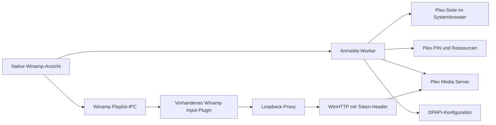

# Architektur

## Aktuelle Komponenten

| Bereich | Verantwortung |
| --- | --- |
| `src/plugin` | SDK-Descriptor, Export, Knotenregistrierung, Lifecycle, Winamp-Playlist-IPC und Besitz des Wiedergabe-Proxys |
| `src/ui` | Native Unicode-Dialoge, deutsche und englische Beschriftungen, Anmeldung, Verbindungsstatus |
| `src/plex/http_stream.cpp` | Asynchrone WinHTTP-Requests, TLS, Timeouts, Abbruch, Header- und Bytezugriff |
| `src/plex/auth.cpp` | Starker PIN, Browser-Anmelde-URL, Ressourcen, Serveridentität und Musikbibliotheken |
| `src/playback/proxy.cpp` | Loopback-Listener, begrenzte Worker, befristeter Grant und Range-Streaming |
| `src/config` | Benutzergebundene DPAPI-Datei und atomarer Austausch |
| `src/common` | Origin-, Token-, Pfad-, Request- und Range-Prüfung sowie Query-Encoding |
| `tests` | SDK-Host, synthetischer PMS-Transport und Tests unabhängiger Komponenten |

Eine eigenständige Cache- und allgemeine Bibliotheksschicht wird erst nach der ersten echten Wiedergabevalidierung ergänzt. Leere Produktmodule werden nicht als implementierte Funktion angelegt.

## Datenfluss

Plexa ist die Verhaltensreferenz für Anmeldung, Auswahl und Mediengateway. Es wird kein Node-Prozess und kein Alexa-Endpunkt eingebettet. Der Proxy ist ein internes Transportmodul, kein externer Dienst.

## Threading und Besitz

Winamp ruft Plugin-Core und Dialogprozeduren auf seinem UI-Thread auf. Nur dieser Thread sendet Playlist-IPC und verändert Steuerelemente. Der Anmeldedialog besitzt einen Worker und ein Stop-Event. Ergebnisdaten werden unter einem Mutex veröffentlicht; `PostMessage` überträgt nur eine Benachrichtigung, keine frei schwebenden Ergebnis-Pointer.

Der Proxy besitzt vier begrenzte Worker. Sie bedienen einen nicht blockierenden Loopback-Listener und pro Worker höchstens einen Client. Die Headergröße ist auf 16 KiB beschränkt; ein Client darf seine Header nicht unbegrenzt langsam senden. Medienbytes werden in 64-KiB-Blöcken weitergegeben, nicht vollständig im Speicher gepuffert.

WinHTTP verwendet asynchrone Handles. Ein Worker wartet auf Abschluss oder Abbruch, während die Winamp-Oberfläche weiterarbeitet. Ein WinHTTP-Callback greift nur auf seinen Request-Kontext zu. Der Kontext wird erst nach `HANDLE_CLOSING` freigegeben. Beim Beenden werden Stop-Events gesetzt, ausstehende Requests abgebrochen und Threads verbunden. Ein eigener Thread wird nicht detached weiterlaufen gelassen.

Die Wiedergabe gehört dem Plugin-Core und überlebt das Zerstören einer Bibliotheksansicht. Der Phase-1-Grant repräsentiert genau eine Datei. Mehrere Titel benötigen eine spätere Zuordnung mehrerer unabhängiger Grants, einschließlich Lebensdauer und Freigabe.

## Authentifizierung und Konfiguration

Ein zufälliger Client-Identifier wird mit der Verbindung gespeichert. Bei der Browseranmeldung läuft das Passwort ausschließlich durch Plex. Der Account-Token dient dem Abruf der Serverressourcen. Danach verwendet die Verbindung den Token der ausgewählten Serverressource. Der Account-Token wird nicht dauerhaft gespeichert.

Die Konfiguration ist als Ganzes mit DPAPI `CurrentUser` verschlüsselt. Das Plugin schreibt eine temporäre verschlüsselte Datei und tauscht sie mit `MoveFileExW` aus. Das Format enthält Client-ID, Serveridentität, Origin, Servername, Ressourcen-Token, Bibliotheks-ID, Bibliothekstitel und Sprache. Defekte oder nicht entschlüsselbare Konfiguration ist ein Fehler, kein Anlass, Zugangsdaten aus anderen Dateien zu suchen.

Es gibt kein Logging von Tokens, Account-Antworten oder Medien-URLs mit Anmeldedaten. Windows-Prozessspeicher bleibt eine systembedingte Grenze: DPAPI schützt gespeicherte Daten, nicht vor Code mit Zugriff auf den laufenden Benutzerprozess. Temporäre eigene Tokenpuffer werden nach Möglichkeit überschrieben; allgemeine JSON- und String-Kopien können keine umfassende Speicherlöschung garantieren.

## Playback und lokale HTTP-Sicherheit

Die Standardarchitektur ist Direct Play. Winamp erhält eine URL der Form `http://127.0.0.1:<port>/stream/<zufall>/audio.<format>`. Die 192-Bit-Capability ist nicht der Plex-Token und enthält keine Serverkennung. Sie gilt höchstens zwei Stunden und nur für die eine zugeordnete Datei. Eine dauerhafte Playlist darf daraus keine dauerhafte Plex-Zugangsmöglichkeit ableiten.

Der Listener verwendet ausschließlich Loopback und exklusive Portbindung. Host-Header, Methode, Capability und optionaler einzelner Byte-Range werden geprüft. Browser-Origin, fremder Host, Request-Body, Transfer-Encoding, Mehrfach-Range und abweichender Pfad werden abgewiesen, bevor ein Upstream-Request entsteht. Es gibt keinen allgemeinen URL-Proxy und keine Weiterleitung frei gewählter Ziele.

An Plex werden Token und Client-Header serverseitig angefügt. Zertifikatsprüfung bleibt aktiv. Redirects, automatische Windows-Anmeldedaten und HTTP-Kompression werden nicht als Ausweichpfade verwendet. Nur Medienheader werden weitergegeben; Fehlermeldungstexte, Cookies und Location bleiben intern.

## Fehlergrenzen und Erweiterungen

Alle ABI-Einstiegspunkte und Thread-Einstiege fangen Ausnahmen ab. JSON-Parserfehler werden vor der UI-Grenze in feste Fehlertypen übersetzt. Die UI zeigt Zustände und Codes, keine fremden Antworttexte. Eine nicht erreichbare Verbindung startet kein Transcoding und wechselt nicht auf unsicheres HTTP.

Für die nächsten Schritte werden API-Modelle von Ansichtszeilen getrennt. Stabile Plex-IDs werden verwendet; UI-Zeilenpositionen sind keine Identität. Seiten sollen anhand tatsächlicher Offsets verarbeitet werden. Ein begrenzter, zeitlich gültiger Metadaten-Cache muss Server, Bibliothek, Query und Sortierung in seinen Schlüssel aufnehmen. Der Cache darf weder Tokens noch vollständige authentifizierte URLs speichern. Noch nicht implementierte Bereiche sind in [testing.md](testing.md) aufgeführt.
