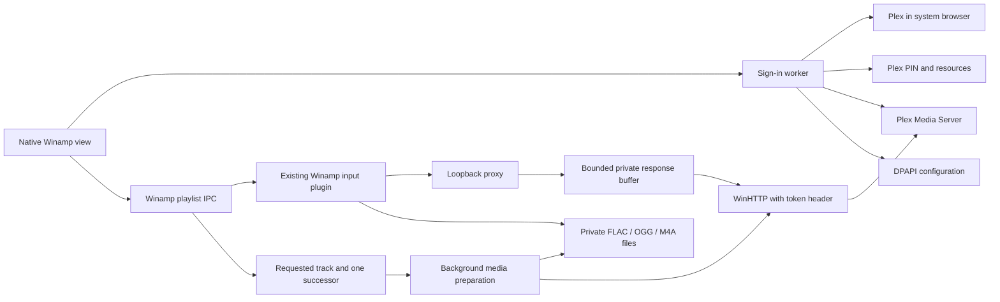

# Architecture

## Storage units and limits

Diagnostics and current user documentation use decimal MB (1 MB = 1,000,000 bytes). Displayed values are truncated to one decimal place, not rounded. German uses a decimal comma. The underlying limits remain unchanged:

| Limit | MB (one decimal) | Exact bytes |
| --- | ---: | ---: |
| Prepared file or response buffer | 536.8 | 536,870,912 |
| Shared private media storage | 2147.4 | 2,147,483,648 |
| Individual streaming-prefetch file | 33.5 | 33,554,432 |
| Combined streaming-prefetch cache | 67.1 | 67,108,864 |
| Protected playback-reference registry | 67.1 | 67,108,864 |
| Shared playback artwork | 67.1 | 67,108,864 |
| Connection configuration | 1.0 | 1,048,576 |

The reference registry, artwork and configuration have separate limits; they are not additional audio-buffer capacity. Diagnostic received/sent counters are cumulative, while reserved storage and next-track cache are current values. Exact failed-transfer counts remain in bytes.

## Components

### Track information

The `TrackInformationController` subclasses the player and playlist editor on their UI thread. Only exact names present in the plugin's bound playback-metadata map are handled. Winamp File Information, the playlist editor's selected-entry information command and ANSI/Unicode information IPC open a native read-only panel. A mixed selection snapshots names in playlist order and sends foreign entries back through Winamp's information IPC; Cancel stops the sequence. Shutdown removes both subclasses before releasing playback state.

The panel receives a copy of nine permitted music fields, with no transport or connection object. It performs no networking, displays no playback URL, server address, media path or Plex identifier, and cannot modify metadata. Missing fields show a dash. Genre tags are parsed from Plex's optional `Genre` array with a bounded count and validated string values. Normal decoder information remains available for unowned entries; an obsolete Plex entry must first be resolved through playback before its music fields can be shown.

This panel does not inject ICY metadata, modify media bytes, change HTTP ranges or alter decoder playback. The MP3 decoder's Stream Info page queries decoder-specific stream fields directly rather than the Media Library metadata hook; adding values to that hook alone cannot populate that page.

The regular plugin restores registered Plex playback entries across process restarts using current authorization and protected server/track/media-part mappings. The separately built feasibility module remains a test artifact and is never packaged.

| Area | Responsibility |
| --- | --- |
| `src/plugin` | SDK descriptor/export, navigation nodes, lifecycle, playlist IPC and playback ownership |
| `src/ui` | Native Unicode dialogs, virtual tables, separate presentation models, workers, sign-in and skin integration |
| `src/plex/http_stream.cpp` | Asynchronous WinHTTP, TLS, timeouts, cancellation, headers and bytes |
| `src/plex/auth.cpp` | Strong PIN flow, browser URL, resources, server identity and music libraries |
| `src/plex/catalog.cpp` | Typed models, artists/albums/tracks/playlists, validated queries and pagination |
| `src/plex/feedback.cpp` | Rating/timeline requests, TLS, time units and bounded responses |
| `src/plex/artwork.cpp` | Validated relative artwork paths, authenticated image transport and bounded WIC decoding |
| `src/ui/artwork_loader.cpp` | Demand-driven artwork/count jobs, generation checks and shared bounded cache |
| `src/plugin/artwork_provider.cpp` | Prepared-data album-art service for owned playback paths, without callback networking |
| `src/cache` | Thread-safe LRU metadata pages, library lists and artwork caching |
| `src/playback/proxy.cpp` | Loopback listener, bounded workers, expiring grants and range streaming |
| `src/playback/stream_buffer.cpp` | Progressive private-disk buffering, one producer/reader per response, startup threshold and cancellation |
| `src/playback/local_media.cpp` | Cancellable FLAC/OGG/ADTS-AAC preparation, private files, quotas and cleanup |
| `src/playback/aac_remux.cpp` | Lossless ADTS-to-M4A repackaging using Media Foundation, without an encoder/decoder |
| `src/playback/playback_reporter.cpp` | State comparison, bounded timeline queue and cancellable background delivery |
| `src/config` | User-bound DPAPI configuration and atomic replacement |
| `src/common` | Origin, token, path, request and range validation; query encoding |
| `tests` | SDK host, synthetic PMS transport and independent component tests |

The progressive buffer has automated and native integration evidence and is not included in the v0.1.0 release. See [testing.md](testing.md) for the tested conditions and their limits.

## Library views and caches

Views use `LVS_OWNERDATA` and pages of up to 250 items. Search is debounced. A new request cancels its predecessor, and generation IDs reject stale results. Album and playlist jobs resolve tracks in workers before the UI hands them to Winamp. Stable Plex IDs identify entities; row positions do not.

`BrowseQuery` is independent of UI and connection models. Genre/year/audio-codec predicates form part of the authenticated server query and page-cache key. A filters worker loads actual server choices before opening the native skinned panel; it performs no network operations in the modal UI. Artists offer genre, albums add year, and tracks add audio codec. Track year means `album.year`. Playlist views support named searches without these media predicates. Saved views are scoped to server, library and item type. Query validation also applies when loading persisted views.

Current navigation, bounded history, page offsets, selected/focused Plex IDs and top visible Plex ID are stored with CurrentUser DPAPI. Winamp may create a replacement view before destroying its predecessor, so the constructor first captures existing live views. Restoration happens after the corresponding page arrives and generation checks pass. Pure UI-preference writes do not invalidate connection verification or stop playback. Up to 32 bookmarks and 64 named searches fit within the existing 1.0 MB configuration limit. User-entered view names replace an existing view with the same scope/name; deletion is explicit.

The metadata LRU holds 32 pages for five minutes. Keys include server identity, connection generation and validated query/library/sort fields, never tokens. Connection changes and explicit clearing invalidate it.

With caching enabled, `LibraryCache` shares one library list across view workers for five minutes. Server identity, connection revision and cache scope separate sessions. The initial TLS/identity validation is still required. Disabled caching bypasses storage; refresh reloads libraries; expiration does not hide request failures. Network calls run outside cache locks.

Artwork and supplementary album/playlist counts share up to 64 entries with a five-minute TTL. Thumbnails are at most 48 × 48 BGRA pixels. Keys separate server, scope and media ID; the lock protects lookup and LRU state only. Clearing advances a generation so in-flight work cannot repopulate stale data. Connection changes and shutdown release entries. Workers remain bound to their views.

Playlist count/duration enrichment uses the audio-playlist detail endpoint because dynamic-playlist overview values may be stale. Results are bound to the requested playlist and view generation. Playlist rows have no cover image list.

The library header names the music library, using a selector only when more than one exists. The tree identifies root views; context headings and Back appear only in artist/album subviews. Paging actions are explicit. Narrow layouts place library identification, search actions and paging on separate rows.

## Ratings and timeline

Personal track ratings are optional API values from zero to ten. The UI divides by two and offers a skinned submenu for one selected track. A worker writes and reads back the value. Successful writes invalidate page cache even if readback is cancelled. A failed confirmation does not claim success; the UI asks for refresh.

An invisible message window polls Winamp on its UI thread every 500 ms. Only owned paths map to Plex IDs and durations. Track changes stop the previous session before starting another; foreign files and stop end the owned session. State changes and position jumps over two seconds are reported immediately, ordinary progress every ten seconds.

A worker processes at most 64 queued timeline messages in order. HTTP 401/403 stops automatic reporting without trying other credentials. Classified audio failures take priority over reporting failures. Teardown gives the final stop message up to 500 ms, then cancels and joins. There are no additional player controls.

Multipart positions use known part durations as offsets. Missing reliable offsets produce an unsupported-state report instead of a false total position. This case has code review coverage, not a real multipart integration test. A real natural ending updated history and play count using timeline alone; no separate scrobble path exists.

## Artwork and skin integration

Visible album/track rows use a dedicated artwork worker. Original images come through validated `/library/metadata/{id}/thumb` paths and are scaled by WIC. Download size, source dimensions and pixel count are bounded. The view owns its image list; temporary GDI bitmaps are freed after insertion. Missing paths or HTTP 404 leave an empty image slot. Other image/transport errors are exposed. Missing album counts use a one-item children page and its total.

Tracks use their own thumb or inherited parentThumb. Before playlist handoff, the catalog worker loads each required cover once per job, with a maximum dimension of 256 pixels. The registered `svc_albumArtProvider` returns prepared PNG bytes only for owned paths, using Winamp's allocator for image/type buffers and SDK type string `png`. HTTP tracks require `ALBUMARTPROVIDER_TYPE_EMBEDDED`; the mapping is separate from the media bytes. Shared image data is capped at 67.1 MB and 10,000 mappings. Revocation/shutdown remove mappings and unregister the service. Missing host services fail initialization.

`ML_IPC_SKINWINDOW` binds dialogs and direct controls to Media Library colors, fonts and cursors. No private color palette is introduced. Context menus use `ML_IPC_TRACKSKINNEDPOPUPEX`. Skin subclasses are released with the documented destruction lifecycle.

## Data flow

Plexa is a behavioral reference for authentication, selection and media gateway design. No Node process or Alexa endpoint is embedded. The proxy is an internal transport module.

## Private media preparation

FLAC and OGG use local files because their target decoders lack the necessary HTTP behavior. The selected Plex Part is unchanged, without transcoding. A playlist worker downloads only the requested or predicted successor file fully before the decoder opens it. Initial catalog handoff only issues a protected deferred alias. HTTP errors, absent or inconsistent lengths, cancellation and quota violations fail the job. MP3 and existing M4A use the proxy; errors do not switch playback paths.

ADTS-AAC is also prepared before decoder startup. HTTP AAC seeking fails in the target decoder, and raw local ADTS duration is inaccurate for the synthetic fixture. Media Foundation therefore reads compressed ADTS samples with converters disabled; the worker strips framing and writes unchanged AAC payloads as `MEDIASUBTYPE_RAW_AAC1` in M4A. Timestamps derive from 1024 samples per frame and sample rate. No encoder or decoder is created.

Byte accounting detects skipped/truncated frames and accounts separately for known ID3 metadata. Program Config Elements, multiple raw blocks per frame and more than two million frames are rejected. Input/output both count toward quota during preparation. Failed outputs are removed; existing files are never overwritten. Required Windows DLLs load only from System32 and only for AAC.

Session directory and media names each use 192 random bits. A protected DACL grants only the current user and SYSTEM access. Limits are 536.8 MB per file and 2147.4 MB total. A retained read handle prevents modification. Files still held by decoders remain accounted for and are retried for deletion. Owned current playback is stopped before releasing storage.

Crash cleanup accepts only marked sessions containing recognized owned filenames, rejects reparse points and uses exclusive marker access to protect active instances. Unknown directories remain untouched.

Playlist handoff accepts local aliases only from the actual session directory with the exact random FLAC/OGG/M4A naming contract. Metadata and covers map to the Unicode path. The resolver releases unused prepared targets; connection changes and shutdown release remaining files. HTTP grant expiry does not apply.

## Threading and ownership

Only Winamp's UI thread changes controls and sends playlist IPC. The sign-in dialog owns a worker and stop event. Results publish under a mutex; PostMessage carries a notification, not an unmanaged result pointer.

On view destruction, the UI detaches image-list and skin resources and sets catalog/artwork stop events. `ViewReaper` takes their live state through an intrusive queue without further allocation. Its own thread joins workers and frees state; navigation does not wait. At most eight pending views, including active teardown, are allowed. Exhaustion fails additional view creation explicitly.

The reaper owns a `CoInitializeEx` MTA apartment for its thread lifetime and closes it on that same thread. Plugin shutdown destroys windows, drains the queue and joins the reaper before unload. There are no detached workers or asynchronous MTA-cookie teardown.

The proxy has four workers, each serving at most one client. Headers are capped at 16 KiB with a finite header deadline. Each active response owns one producer thread, a cancellation event and a random private .buffer file. No thread is allocated merely for a queued playlist entry.

The producer reads WinHTTP in 64 KiB blocks independently of downstream backpressure. Only written bytes become visible to the consumer. The consumer starts after 128 KiB or producer completion, then reads published bytes by offset. An unfinished buffer wait returns control at most every 100 ms so a closed decoder connection can cancel its upstream request. Global shutdown and per-response cancellation both interrupt WinHTTP waits. Teardown cancels and joins the producer before deleting the file.

Known Content-Length reserves quota before starting the body. Unknown-length responses reserve incrementally. Buffers share the prepared-media budget: 536.8 MB per file and 2147.4 MB overall. Quota exhaustion and disk errors remain explicit failures, without an unbuffered alternative. Completed network downloads release WinHTTP resources even while the consumer is paused. Ordinary response buffers remain only for the active response. Uncached range requests receive their own buffer and retain their original HTTP status and byte offsets.

A single additional worker speculatively prepares the next owned sequential playlist URL. UI polling reads Winamp's playlist position and verified SDK shuffle state; it never changes the playlist or predicts shuffle order. Foreign local/radio entries are ignored. Each speculative file requires HTTP 200, identity encoding, a positive known length of at most 33.5 MB and exact completion. The index retains only current/next files (at most 67.1 MB); active HTTP readers retain their own references until they finish. All reservations still count toward the shared 2147.4 MB budget. The worker waits for active ordinary downloads and a new uncached media request cancels speculative work. Target changes, stop and shutdown cancel and join the worker. Speculation errors are reported separately from real playback errors.

Completed prefetched bytes are served through the original grant after the same TTL, host-process, origin and revocation checks. GET/HEAD, bounded/open/suffix ranges and HTTP 416 are supported. No token or PMS address enters the local URL. Partial files are never published, and a cache miss uses the ordinary authenticated media request. FLAC/OGG/AAC aliases enter the playlist before their files exist. The playlist resolver prepares the requested local file before decoder startup and may prepare one predicted successor; these files do not use the streaming proxy's speculative-copy cache. This is neither an offline library nor a guarantee against outages exceeding available data.

Buffered bytes are drained before a terminal producer error is reported. The last failure remains recorded. Budget changes stay serialized with file ownership; numeric byte-use diagnostics are atomic and do not wait for filesystem cleanup on the UI thread.

The native diagnostics panel samples these counters every second without network requests. Received/sent MB accumulate over the proxy lifetime, including repeated range requests. Active downloads count streaming producers; zero does not establish that any specific track is cached. Reserved storage is the shared private-store quota, including prepared local formats even when no proxy exists. It is not the number of bytes already downloaded. The timer is removed when the panel is destroyed; error counts retain their separate meaning.

WinHTTP uses asynchronous handles. Workers wait for completion or cancellation while the UI remains responsive. Callbacks touch only request context. After HANDLE_CLOSING, connection/session handles close; the transport then waits for [WINHTTP_OPTION_UNLOAD_NOTIFY_EVENT](https://learn.microsoft.com/en-us/windows/win32/winhttp/option-flags#winhttp_option_unload_notify_event), confirming all callbacks have returned before context and code are freed. HANDLE_CLOSING delivery alone is insufficient.

Playback belongs to the core and survives view destruction. A shared listener supports up to 10,000 grants. Adding tracks preserves earlier grants; failed handoff revokes only newly issued ones. Connection teardown revokes all.

`send_playlist_to_winamp` handles synchronous SDK calls and verifies imported count. Insert-after-current hands M3U8 to the playlist editor without a playback command. The reporter is allocated before modifying the host. Partial imports are errors; atomic host rollback is not promised.

## Saved-playlist restoration

`src/config/replay_references.cpp` records each issued playback alias together with Plex server ID, numeric track ID and validated media-part key. The entire registry is protected by CurrentUser DPAPI and atomically replaced. A cancellable exclusive sidecar handle serializes concurrent writers; each merge rereads the current file while holding that handle. Corruption, conflicting alias assignments, decryption failures and limits are errors. There is no TTL or automatic eviction. Bounds are 100000 aliases and 67.1 MB. Repeated imports of an old alias reuse its current-session target rather than issuing another grant.

`src/plugin/playlist_replay.cpp` owns one COM-initialized worker and bounded job queues. Normal library handoff first binds temporary targets, then persists their references on this worker, and only then imports them into Winamp. A failed save revokes the new targets. Shared prepared files retain a binding claim for each accepted or pending handoff; rejecting another handoff cannot revoke an existing entry's file or metadata. No network or DPAPI-registry operation runs on Winamp's UI thread.

Library handoffs use a separate generation and cancellation event from speculative resolution. A new handoff cancels current speculative work without cancelling another queued handoff or current audio. Stop and connection teardown cancel both kinds of work. Queued work checks its generation before starting, so an obsolete download cannot delay a new request after cancellation.

Before Play, IPC_STARTPLAY, playlist-editor Play/Enter/double-click, Previous/Next or decoder EOF advances to an obsolete owned target, the controller holds that action and snapshots the full playlist. Its worker looks up exact aliases, requires the selected server ID to match, verifies TLS/server identity using the existing connection selector, and retrieves `/library/metadata/{id}`. The recorded part must still exist exactly; no title matching, different credentials, transcoding or substitute media are used. Metadata requests are deduplicated per track, local downloads per part and artwork per thumbnail. Ordinary unrelated sources are retained.

Explicitly selected foreign sources bypass Plex resolution, including a broken Plex registry elsewhere in the list. Previous/Next and first/last commands let Winamp select a position while stopped, including its native shuffle table. Navigation at an unchanged boundary restores elapsed time and pause. A queue override is consumed once for that actual command and retained while resuming; speculative loading never queries queue overrides. Automatic advance also selects through Winamp's stopped Next command before resolving the actual target. It respects manual advance, repeat and Stop After Current; known terminal/Stop cases remain with the native EOF handler. The predicted index is used only for prefetch because a changed or wrapped shuffle table can invalidate it. Paused Play resumes the existing decoder without resolving unrelated entries. Own HTTP aliases require the exact loopback grant-path shape. Local files outside the private playback directory and web radios keep their addresses and positions. Third-party queue plugins remain unverified.

Only the requested stale entry is resolved before its action resumes. Initial library handoff creates random private deferred paths for local decoder formats without downloading media or reserving file bytes. The protected alias maps those paths to exact Plex identities. Every 500 ms the UI samples the native expected successor and may prepare that one entry on the same worker. A user playback request cancels speculative work before submitting its own job. Speculative errors are retained as a diagnostic code without interrupting current audio; requesting that entry reports failures normally. Prepared formats retain the existing 536.8 MB file / 2147.4 MB shared-media limits; streaming formats keep progressive buffering. Bindings include title, separate metadata, artwork and timeline offsets. Multipart replay lacks real integration evidence.

Restored targets outside the actual decoder filename and predicted successor are released, returning private-file storage to the shared budget. During a requested transition, an old decoder/file and the previous successor can remain alive until the new target is committed; this is bounded transition overlap, not retention of the whole playlist. Evicted aliases remain in the protected registry and are resolved again when requested. Duplicate playlist aliases can reuse a live restored target. There is no persistent offline audio cache.

The UI verifies connection revision, playlist contents and current position before binding and again before replacement. Stop, connection changes and playlist-modified notifications cancel pending restoration; stale results cannot resume playback. `IPC_CHANGECURRENTFILEW` replaces the filename at its existing position and the cursor is restored. No insertion/deletion rebuilds the shuffle table. Atomic rollback against another plugin mutating the list reentrantly is not promised. Failures use fixed text and a numeric code, never raw URLs or exceptions. Shutdown cancels and joins the worker before destroying its notification window or playback services.

Restoration is same-user, same-profile and selected-server scoped. Exported files contain local aliases without PMS URLs, media paths or tokens; those aliases use the protected registry rather than permanent HTTP grants. Keep `playlist-references.dpapi` with saved playlists. Lost mappings cannot be reconstructed. Offline playback, multi-server restoration and arbitrary startup/autoplay plugins are not verified. Up to 10000 total playlist entries are supported by restoration.

### Isolated feasibility module

`tests/playlist_replay_probe.cpp` builds a separate Media Library test module. It persists old playback-target → Plex server/track-ID mappings with user-bound DPAPI. On restart, it reads those mappings, intercepts a playback request, verifies the selected server's identity/TLS and resolves `/library/metadata/{id}` on a worker. New proxy grants or newly prepared private files replace the stale playlist entries through original playlist-editor IPC. The saved source playlist is not modified. No Plex tokens, server addresses or media paths are added to exported playlists.

Both main-window and playlist-editor subclassing are needed. The editor can call StartPlaying directly, bypassing the main Play command. The probe gates main Play, IPC_STARTPLAY, editor Play selection, Enter and row double-click before the decoder opens an obsolete target. A pending request resumes on the UI thread after replacement. It eagerly resolves all owned entries in the two-track fixture, so normal automatic advancement and shuffle subsequently use valid targets. It does not decode audio or keep a permanent proxy port.

This remains a bounded proof: two bootstrap titles, one selected server, one media part per track and at most 100 historical aliases. The regular implementation above has separate persistence, cancellation and service bindings. Existing entries whose ID mapping was already lost cannot be reconstructed reliably from title text. The normal installation is not a target of either native test.

## Authentication and configuration

A random client ID is saved with the connection. Settings open without sign-in; only the explicit button creates a strong PIN and opens the browser. Password handling stays with Plex. The account token is transient; stored profiles contain each resource token and its advertised HTTPS connections.

Connection validation probes up to 32 connections per server using normal TLS and unauthenticated identity. Local precedes direct remote and relay. Only matching identity allows authenticated library access. Authentication denial does not continue route search. Advanced manual origins require the same identity check.

Opening Settings validates the saved route and loads libraries in the background. Cancel does not save draft changes and stops/joins workers. Only one settings dialog is allowed.

The first catalog job after startup uses the same route validator with only the selected profile's connections/token. Later jobs use the validated session origin. Profile revision rejects stale results. Origin changes revoke playback mappings and clear cache; automatic session routing does not write DPAPI. Settings changes require revalidation before playback handoff.

A native modal frame hosts an embedded gen_ml view. Advanced fields begin hidden; showing them moves subsequent rows and resizes the frame together. Hidden fields have neither active skin subclasses nor tab stops. Showing them registers the documented subclasses again. Language comes from `IPC_GETLANGUAGEPACKINSTANCE` with `MAKEWPARAM(5, LANG_LANG_CODE)`.

The entire configuration is encrypted with DPAPI CurrentUser, written to a temporary encrypted file and atomically replaced with `MoveFileExW`. It contains client/server identity, origin/name/token, library ID/title, cache option, custom origin, known profiles/connections, named searches and library navigation bookmarks. There is no saved language preference. Limits are 1.0 MB, 64 servers, 32 connections per server, 64 searches and 32 bookmarks. Corruption/decryption failure is an error, never a reason to search other files for credentials.

Tokens, account responses and authenticated URLs are not logged. DPAPI protects stored bytes, not a process already accessible to the current user. Temporary token buffers are overwritten where practical; JSON/string copies prevent any guarantee of comprehensive memory erasure.

## Playback and local HTTP security

Nonblocking client sockets wait through full decoder buffers and pause. Write readiness and stop are checked at intervals no greater than 100 ms, so shutdown interrupts a permanently stalled receiver.

The running Winamp instance may use expired exported capabilities only when Windows `GetExtendedTcpTable` confirms it owns that exact TCP client connection. Lookup failures are transport errors; identity is never trusted from HTTP headers. Foreign processes still receive HTTP 410, and expiry timestamps are not extended. See [Microsoft's TCP owner-PID contract](https://learn.microsoft.com/en-us/windows/win32/api/tcpmib/ns-tcpmib-mib_tcprow_owner_pid).

Queued host grants remain until revocation, connection change or shutdown, subject to the 10,000 mapping limit. PID identity does not bypass path, Host, Origin, method or revocation checks. Tools/tests default to capability-only access unless explicitly configured. Short native expiry tests verify progress/seeking while foreign access remains denied.

Expired grants return HTTP 410 and request_expired without contacting PMS or opening sign-in. The UI requests re-adding the track. Successful access through a fresh grant clears that local-expiry indication.

The listener uses loopback and exclusive binding. Host, method, capability and a single optional range are validated before upstream access. Browser Origin, foreign Host, request bodies, Transfer-Encoding, multiple ranges and altered paths are rejected. There is no arbitrary destination proxy.

Plex authentication is attached upstream only. TLS verification stays enabled. Redirects, automatic Windows credentials and HTTP compression are not alternate execution paths. Only selected media headers pass through; private error text, cookies and Location remain internal.

## Failure boundaries

An interrupted full response may resume at the next byte not yet downloaded into the buffer, at most three times. The resume offset is independent of how much Winamp has consumed. Known total length and a strong ETag are required. Follow-up requests use the same origin/token/path and must return HTTP 206, the same ETag, exact Content-Range and remaining Content-Length. Authentication failure or mismatch fails visibly. Initial HTTP 206 seeking responses are excluded from resumption. Numeric diagnostics retain the latest transfer failure after recovery or a subsequent healthy track; received/expected counts describe upstream progress.

ABI/thread entry points catch exceptions. JSON failures become classified errors before reaching the UI. Unreachable servers never trigger transcoding or insecure HTTP. Unverified areas are listed in [testing.md](testing.md).
